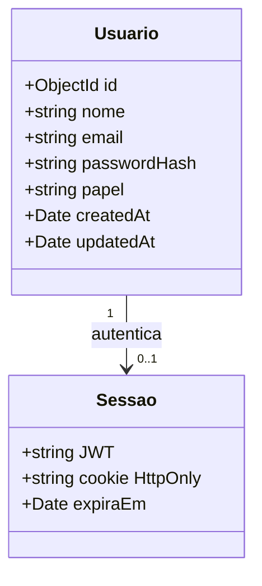
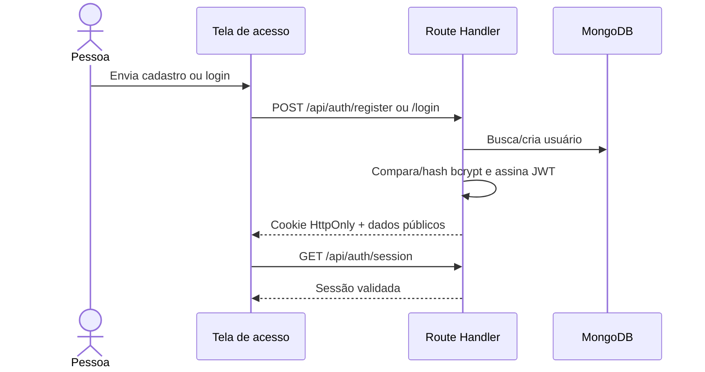

# taskform | Gerenciador Kanban

**Cliente:** Agência Criativa StartUp  
**Responsável:** DevSolutions  
**Documento atualizado:** 2026-10-29  
**Status:** MVP com autenticação e persistência de contas no MongoDB

## Visão do produto

Workspace para organizar projetos e tarefas de uma equipe criativa em quadros Kanban. O acesso exige uma conta; cada conta tem autenticação própria. Neste MVP, os dados do quadro continuam locais ao navegador e separados por usuário.

## Requisitos funcionais

| ID | Requisito | Situação |
|---|---|---|
| RF-01 | Criar conta com nome, e-mail e senha | Implementado; senha com hash bcrypt |
| RF-02 | Entrar com e-mail e senha | Implementado; credenciais consultadas no MongoDB |
| RF-03 | Manter sessão autenticada | Implementado com JWT em cookie HttpOnly, SameSite=Lax e validade de 7 dias |
| RF-04 | Sair da conta | Implementado; remove o cookie de sessão |
| RF-05 | Impedir acesso anônimo ao quadro | Implementado; visitantes são enviados para `/login` |
| RF-06 | Verificar conectividade do MongoDB | Implementado em `GET /api/health/db` |
| RF-07 | CRUD de projetos e tarefas no Kanban | Implementado no navegador com armazenamento separado por conta |

## Requisitos não funcionais

| ID | Requisito | Decisão |
|---|---|---|
| RNF-01 | Senhas protegidas | bcrypt com custo 12; senha em texto puro nunca é persistida |
| RNF-02 | Segredo da sessão | JWT HS256; `JWT_SECRET` de pelo menos 32 caracteres, mantido somente no servidor |
| RNF-03 | Segurança do cookie | HttpOnly, SameSite=Lax, Secure em produção, caminho `/` |
| RNF-04 | Validação de entrada | Nome, e-mail e comprimento de senha validados no servidor |
| RNF-05 | Persistência de usuários | MongoDB/Mongoose com conexão reutilizada entre invocações |
| RNF-06 | Responsividade e acessibilidade | Interface adaptável, labels, foco visível e movimento reduzido |
| RNF-07 | Privacidade de erros | Respostas não retornam URI, hash, senha ou detalhes internos do banco |

## Executar localmente
Aqui estão os passos para executar localmente o software:

Requisitos: Node.js compatível com o Next.js instalado, npm e MongoDB local ou MongoDB Atlas.

1. Instale dependências e crie sua configuração local:

```powershell
npm install
Copy-Item .env.example .env.local
```

2. Edite `.env.local` com sua conexão. Para MongoDB local, o exemplo usa `mongodb://127.0.0.1:27017/taskform`. Para Atlas, use uma URI `mongodb+srv://...`, substituindo os marcadores pelos dados do seu cluster. Codifique caracteres especiais do usuário/senha da URI.

3. Gere um segredo JWT forte:

```powershell
node -e "console.log(require('node:crypto').randomBytes(32).toString('base64url'))"
```

Cole o valor gerado em `JWT_SECRET` dentro de `.env.local`. Não compartilhe nem versione esse arquivo. Reinicie o servidor depois de mudar variáveis de ambiente.

4. Inicie a aplicação:

```powershell
npm run dev
```

Acesse `http://localhost:3000`. Crie uma conta na tela de entrada. Novas contas recebem o papel `member`.

## Verificar MongoDB

Com `.env.local` preenchido e o MongoDB acessível, consulte:

```powershell
Invoke-RestMethod http://localhost:3000/api/health/db
```

Sucesso retorna HTTP 200 com `{"status":"ok","database":"connected"}`. Falha retorna HTTP 503 com uma mensagem genérica; confira `MONGODB_URI`, se o serviço/cluster está ativo, usuário e senha, allowlist de IP do Atlas e regras de rede. O endpoint não expõe credenciais.

**Estado deste ambiente:** a conexão local `mongodb://127.0.0.1:27017/daymark` respondeu ao ping, e o fluxo de cadastro/login foi testado com um usuário temporário removido ao final. A URI e o JWT secreto foram usados apenas no processo de teste; `.env.local` não foi criado. Para executar depois, configure as variáveis conforme a seção anterior. A conexão não autenticada ao Mongo local foi validada; nenhuma URI do Atlas foi fornecida para teste.

## Rotas de autenticação

| Método | Rota | Ação |
|---|---|---|
| `POST` | `/api/auth/register` | Cria usuário e inicia sessão |
| `POST` | `/api/auth/login` | Valida credenciais e inicia sessão |
| `GET` | `/api/auth/session` | Retorna os dados públicos da sessão autenticada |
| `POST` | `/api/auth/logout` | Encerra a sessão |
| `GET` | `/api/health/db` | Faz ping ao MongoDB |

## Modelo e fluxo de autenticação





## Escopo e limitações conhecidas

- O cadastro público cria contas com papel `member`; promoção a gerente deve ser feita por um processo administrativo confiável. Não há seleção de papel privilegiado no formulário.
- Projetos e tarefas ainda usam `localStorage`; não são sincronizados pelo MongoDB entre dispositivos ou membros do time.
- Não há recuperação de senha, verificação de e-mail, rate limiting, MFA ou gestão de sessões/dispositivos. Antes de exposição pública, adicionar essas proteções e revisão de segurança.
- O papel está presente no modelo e na sessão; as operações atuais do quadro ainda não são APIs protegidas por autorização de papel.

## Verificações

```powershell
npm run lint
npm run build
```

## Link da prototipagem no Stitch
https://stitch.google.com/projects/598732742039269341
